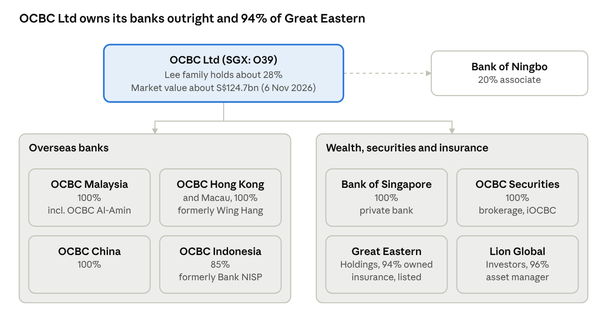
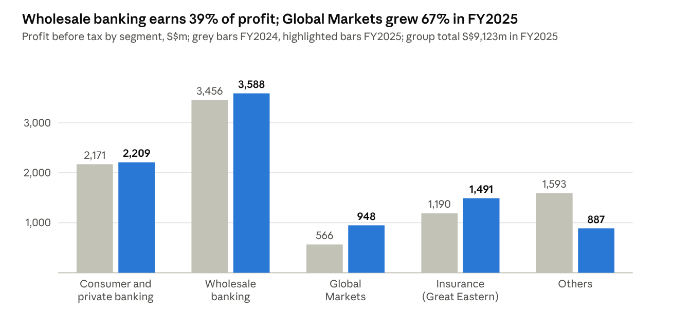
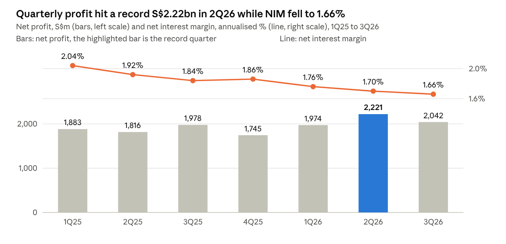
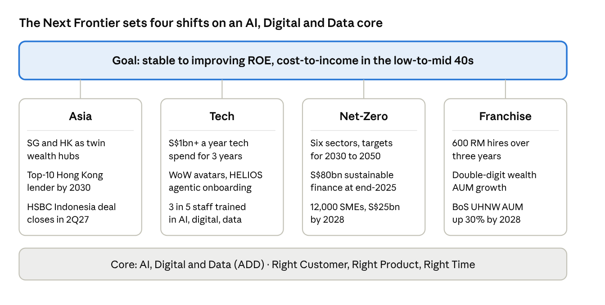
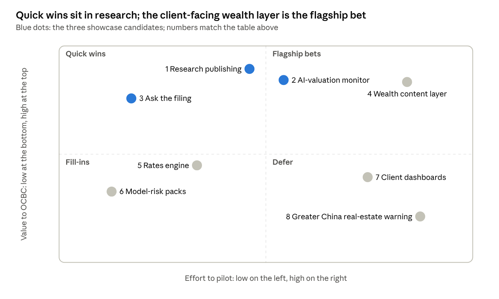

# Executive summary

OCBC is Singapore's second-largest bank, a S$675.7bn-asset, Aa1-rated group that earned a record S$6.24bn in the first nine months of 2026 and trades at about 2x book. It is one year into a new CEO's "Next Frontier" strategy that puts "AI, Digital, Data" at its core, yet it publishes no AI outcome metric and its research output is the thinnest of Singapore's three banks. All facts are as of 7 November 2026.

| OCBC at a glance | Value |
| --- | --- |
| Total assets, end-2025 | S$675.7bn |
| Net profit, nine months to Sep 2026, a record, up 10% | S$6.24bn |
| Return on equity, nine months 2026 | 13.5% |
| Net interest margin, 3Q26 | 1.66% |
| NPL ratio, Sep 2026 | 0.8% |
| CET1 ratio, fully phased-in, Sep 2026 | 14.0% |
| Banking wealth AUM, Sep 2026 | S$358bn |
| Market value, 6 Nov 2026, at S$27.73 a share | S$124.7bn |
| Employees, in 19 markets | 33,000 |
| Credit ratings, Moody's / S&P / Fitch | Aa1 / AA- / AA- |

**Shape.** Three banking segments plus Great Eastern insurance. Wholesale banking makes 39% of profit before tax, consumer and private banking 24%, insurance 16% and Global Markets 10%. Singapore produces 56% of profit, Greater China 18% and Malaysia 15%. The founding Lee family holds about 28%.

**Momentum.** Profits set records while NIM compressed from 2.04% to 1.66% over seven quarters, because wealth (38% of income), trading and insurance carried earnings; 2026 guidance was raised twice. DBS remains larger on every measure and claims about S$1bn a year of AI value; OCBC's one-year share return of 56% is the best of the three local banks.

**Leadership.** Tan Teck Long has been Group CEO since 1 January 2026 and describes OCBC as "very cost conscious". The natural sponsors for an analytics proposal are Kenneth Lai (Global Markets, which owns Group Research and OCBC Securities), Jean Chia (Bank of Singapore CIO), Sunny Quek with Chez Anbu (consumer wealth) and Donald MacDonald (Group Data Office), with Melvyn Low (strategy and data) and Carina Lee (risk) as gatekeepers.

**The gap.** OCBC's research hub is visibly stale and its Singapore equity stream thin, DBS and UOB outpublish it, A.I. Oscar is the only client-facing AI research product, and nobody at OCBC publishes a valuation metric on AI equities even though Great Eastern and Lion Global name an AI re-rating as the top risk. No Singapore bank has yet bought research automation or forecasting from a vendor.

**The fit.** BharatFinQA supplies an evidence-grounded filings pipeline, scoring harness and judge; FinSafeQA-XL supplies a point-in-time, hash-pinned Singapore knowledge base with a grounding-first, abstention-aware protocol and MAS advice-boundary scoring. The rea repository is a reverse-engineering toolkit with no OCBC content.

**The rules.** A vendor platform must meet MAS Notice 658 on outsourcing, the Technology Risk Management guidelines and the final AI Risk Management guidelines of 7 October 2026, whose model-inventory deadline falls in about October 2027; research reaching clients also sits under the Financial Advisers Act.

> **The thesis for senior leadership.** OCBC has the balance sheet, the wealth franchise and the stated "ADD" ambition, but not the research and forecasting engine to match DBS. A public-data showcase of a research-publishing platform, an AI-valuation monitor and an "ask the filing" assistant, piloted inside Global Markets under MAS-ready terms and then extended to Bank of Singapore and consumer wealth, closes that gap with measurable cost per report, accuracy and revenue outcomes rather than an AI narrative.

# Corporate overview

OCBC is Singapore's second-largest bank by assets, with S$675.7bn of total assets at end-2025, about 33,000 employees and close to 400 branches and offices in 19 markets; the founding Lee family still holds about 28% of the shares.

Oversea-Chinese Banking Corporation was formed in 1932 by the merger of three banks. Growth since then came by acquisition: Keppel Capital (2001), Bank NISP in Indonesia (2004), ING Asia Private Bank, renamed Bank of Singapore (2010), Wing Hang Bank in Hong Kong and Macau (2014), Barclays' Asia wealth business (2016), National Australia Bank's Asia private wealth business (2017), and the unification of all banking subsidiaries under one OCBC brand in 2023.

{width=full}

Every banking subsidiary is wholly owned except OCBC Indonesia at 85%; Great Eastern's 94% is 93.72% economic and about 88.2% voting, and Bank of Ningbo is an equity-accounted associate. Ownership percentages are as stated in the 2025 annual report.

**Great Eastern stays listed.** The S$30.15 exit offer lapsed when the delisting vote failed on 8 July 2025 (63.49% in favour against the 75% needed); a one-for-one bonus issue restored the free float and trading resumed on 21 August 2025. OCBC said it has no further offer "in the foreseeable future", Tan Teck Long called it "a chapter behind us" on 25 February 2026, and Andrew Khoo became Great Eastern chairman on 14 April 2026.

**Listing and ownership.** 4,501,436,229 shares were in issue (10.5m in treasury) at 25 February 2026. Selat holds 14.44% and Lee Foundation 5.13%, and Bloomberg puts the Lee family's combined interest near 28%. The shares closed at S$27.73 on 6 November 2026, a market value of about S$124.7bn, and OCBC is a Straits Times Index constituent.

**Board.** Andrew Lee has chaired the board since 1 February 2023 (director since 18 February 2022). The 2025 annual report lists 10 non-executive directors and seven committees; Tan Ching Yee joined on 1 November 2025 and Tan Yen Yen retired at the 16 April 2026 AGM. The Group CEO does not sit on the board. Open question: OCBC's live leadership page no longer lists Audit Committee chairman Chua Kim Chiu, so a post-April 2026 board change should be verified on SGX before use.

| Role | Name |
| --- | --- |
| Group CEO | Tan Teck Long, since 1 January 2026 (Deputy CEO July to December 2025); succeeded Helen Wong, who retired on 31 December 2025 |
| Group CFO | Goh Chin Yee, since November 2022 |
| Group Chief Risk Officer | Carina Lee, since 1 January 2026 |
| Group Chief Strategy and Transformation Officer, including Group Data | Melvyn Low, since 10 November 2025 |
| Head of Group Operations and Technology | Praveen Raina (OCBC has no Group CIO title) |
| Head of Group Data Office | Donald MacDonald |
| Head of Global Markets, also over OCBC Securities since 1 July 2025 | Kenneth Lai |
| Head of Global Consumer Financial Services | Sunny Quek |
| Head of Global Wholesale Banking | Successor to Tan Teck Long not yet named |
| CEO, Bank of Singapore | Jason Moo |
| Group CEO, Great Eastern Holdings | Greg Hingston |
| CEO, Lion Global Investors | Teo Joo Wah |
| Managing Director, OCBC Securities | Wilson He |
| CEO, OCBC Hong Kong and Greater China | Wang Ke |
| CEO, OCBC Malaysia | Tan Chor Sen |
| President Director, OCBC Indonesia | Parwati Surjaudaja |
| CEO, OCBC China | Ang Eng Siong |

**Credit ratings.** Moody's Aa1, S&P AA-, Fitch AA- with a stable outlook (viability rating aa-, affirmed 14 May 2025). Headcount was 33,323 at end-2025, down 1% on the year.

# Business segments and subsidiaries

Wholesale banking makes 39% of OCBC's profit before tax, consumer and private banking 24%, Great Eastern's insurance 16% and Global Markets 10%. Global Markets grew fastest in FY2025 and since 1 July 2025 houses both Group Research and OCBC Securities, which makes it the natural home for a research platform.

{width=full}

In 1H26 the split was S$1,825m wholesale, S$1,154m consumer and private, S$1,048m insurance, S$523m Global Markets and S$624m others, of a S$5,174m total. In 3Q26 banking operations made a record S$1.90bn while Great Eastern contributed only S$147m because of bond mark-to-market losses.

| Segment | Who runs it | What it covers | FY2025 notes |
| --- | --- | --- | --- |
| Global Consumer and Private Banking | Sunny Quek (consumer); Jason Moo (Bank of Singapore) | Deposits, cards, mortgages, Premier Banking (from S$350,000), Premier Private Client (from S$1.5m and accredited-investor status), Bank of Singapore | Profit before tax S$2,209m; Quek targets doubling the wealth business by 2029 |
| Global Wholesale Banking | Head vacant since Tan Teck Long became Group CEO; Elaine Lam (Corporate), Elaine Heng (Commercial), Gan Kok Kim (Investment Banking), Melvyn Low (Transaction Banking), Tan Yuen Siang (Financial Institutions) | Corporate, commercial, SME, transaction and investment banking | Profit before tax S$3,588m; sustainable finance S$86.0bn committed by September 2026; number one SGD bond bookrunner; Euromoney Asia's best bank for SMEs 2025 |
| Global Markets | Kenneth Lai | Trading, treasury, FX, rates and structured products; since 1 July 2025 also Group Research and Global Markets Equities (OCBC Securities with the Hong Kong and Indonesia broking units) | Profit before tax S$948m, up 67%; FX API, a Markets Watch WhatsApp AI chatbot, tokenised bonds and US$1bn of blockchain commercial paper; stated ambition to build a "comprehensive multi-asset research platform" |
| Insurance | Greg Hingston, Great Eastern | Life and general insurance in Singapore, Malaysia, Indonesia and Brunei | Profit before tax S$1,491m; Great Eastern's own FY2025 profit was a record S$1,207m (+21%) with new business embedded value of S$740m (+19%) |

Wealth runs across the segments: group wealth-management income was S$5.60bn in FY2025 (38% of income) and S$3.29bn in 1H26 (41%), wealth fees were a record S$1.33bn for the nine months of 2026, and banking wealth AUM rose from S$343bn in December 2025 to S$358bn in September 2026. The Wealth Panel combines OCBC, Lion Global and Bank of Singapore views.

| Subsidiary | Ownership | Size and reach | Leadership | Notes |
| --- | --- | --- | --- | --- |
| Bank of Singapore | 100% | AUM about US$124bn at end-2024 and above US$145bn by 3Q25, up more than 20% in 2025; about 500 relationship managers; hubs in Singapore, Hong Kong, Dubai, Luxembourg and Malaysia | CEO Jason Moo; Global CIO Jean Chia | Ambition to be a top-five Asian private bank within three to five years; HOLMES, RM Copilot, an agentic source-of-wealth assistant and HELIOS onboarding |
| Great Eastern Holdings | 93.72% economic interest, 88.23% of voting shares; public float 11.76%; SGX-listed | FY2025 total weighted new sales S$1,535m (down 15%); nine-month 2026 new business embedded value up 23%, sales up 9%, net profit S$952m (down 1%); 3Q26 profit S$103m (down 72%) after a S$57m loss on the partial divestment of Great Eastern Life Indonesia to OCBC Indonesia, completed 1 September 2026 | CEO Greg Hingston; Chairman Andrew Khoo | OCBC is "not proactively looking to further increase its shareholding" |
| Lion Global Investors | 96% (70% through Great Eastern, 30% direct) | AUM S$76.7bn at 30 September 2026 (S$67.4bn in September 2022); 196 staff | CEO Teo Joo Wah; Chairman Seck Wai Kwong | Lion-OCBC Securities ETFs, Singapore's first physical-gold fund and first active bond ETF |
| OCBC Securities | 100%; part of Global Markets Equities since 1 July 2025 | iOCBC covers 15 exchanges with TradingView charts and A.I. Oscar; Euromoney Best Equities House Singapore 2026; no market-share disclosure | Managing Director Wilson He; Chairman Kenneth Lai | A.I. Oscar is the group's only client-facing AI research product |
| OCBC Hong Kong, with Macau and OCBC China | 100% | OCBC Hong Kong FY2025 profit HK$2,678m (up 83%), 1H26 HK$1,827m (up 45%), assets HK$466bn; the mainland China segment made HK$623m of profit before tax on HK$114bn of assets and Macau HK$114m | CEO Wang Ke (Hong Kong and Greater China); CEO Ang Eng Siong (China) | Greater China produced 18% of group profit before tax in FY2025 |
| OCBC Indonesia | 85% | 1H26 net profit Rp2.73tn on assets of Rp329.5tn; acquiring HSBC Indonesia's retail and wealth business (336,000 customers, Rp89.8tn AUM) with closing in 2Q27 | President Director Parwati Surjaudaja | Took a stake in Great Eastern Life Indonesia in September 2026 |
| OCBC Malaysia and OCBC Al-Amin | 100% | 38 branches plus 7 OCBC Al-Amin Islamic-banking branches and 15 Pac Lease branches; Malaysia produced S$1,378m of profit before tax (15% of group) in FY2025 | CEO Tan Chor Sen | Standalone FY2025 results not retrieved |

Geography in FY2025: Singapore produced 59% of income and 56% of profit before tax (62% and 61% in FY2024), Greater China S$1,671m of profit before tax (18%), Malaysia S$1,378m (15%) and Indonesia S$493m (5%). Consumer platforms are the OCBC Digital app, Velocity for businesses, RoboInvest (28 portfolios), Pay Anyone and the WoW avatar app; OCBC discloses no total app user count and no Singapore mortgage or card market share.

# Financial performance

OCBC earned a record S$7.59bn in FY2024 and S$7.42bn in FY2025 (down 2% as margins fell), then a record S$6.24bn in the nine months to September 2026 on 14% loan growth, and the shares have re-rated to about 2x book.

| S$m unless stated | FY2022 (restated) | FY2023 | FY2024 | FY2025 |
| --- | --- | --- | --- | --- |
| Net profit | 5,526 | 7,021 | 7,587 | 7,422 |
| Total income | 11,286 | 13,507 | 14,473 | 14,614 |
| Net interest income | 7,688 | 9,645 | 9,755 | 9,150 |
| Net interest margin | 1.91% | 2.28% | 2.20% | 1.91% |
| Non-interest income | 3,598 | 3,862 | 4,718 | 5,464 |
| of which gross wealth-management fees | 919 | 896 | 1,079 | 1,443 |
| of which net trading income | 929 | 1,004 | 1,537 | 1,684 |
| of which insurance income (Great Eastern) | 803 | 808 | 917 | 1,069 |
| Operating expenses | 4,838 | 5,223 | 5,742 | 5,882 |
| Cost-to-income ratio | 42.9% | 38.7% | 39.7% | 40.2% |
| Credit costs (bp of loans) | 16 | 20 | 19 | 17 |
| NPL ratio | 1.2% | 1.0% | 0.9% | 0.9% |
| Return on equity | 11.1% | 13.7% | 13.7% | 12.6% |
| Earnings per share (S$) | 1.22 | 1.55 | 1.67 | 1.63 |
| Dividend per share | 68c | 82c | 101c (85c ordinary + 16c special) | 99c (83c ordinary + 16c special) |
| Group wealth AUM (S$bn) | 258 | 263 | 299 | 343 |
| CET1 ratio, transitional | 15.2% | 15.9% | 17.1% | 16.9% |

{width=full}

Fee, trading and insurance income carried earnings while net interest income shrank: non-interest income was 45.7% of total income in 2Q26, against 35.8% in 1Q25, and nine-month credit costs were only 14 bp.

**3Q26, released on 6 November 2026.** Net profit of S$2,042m was up 3% on the year and down 8% on the quarter, beating the S$2.00bn consensus. Nine-month profit was a record S$6,237m (+10%), NIM 1.66%, loans up 14% to S$372bn, deposits S$461bn, the NPL ratio 0.8%, CET1 15.5% transitional and 14.0% fully phased-in, ROE 13.1% (13.5% for nine months) and banking wealth AUM S$358bn. Guidance: loan growth in low double digits, income growth of at least mid-single digits, credit costs of 15 to 20 bp, a cost-to-income ratio in the low 40s and a 50% ordinary payout, assuming 3-month SORA near 1.2% and one more Fed hike in 4Q26.

**Capital return.** Of the S$2.5bn plan of February 2025 (10% special dividends for FY2024 and FY2025 plus buybacks), about S$800m remained in August 2026 and will be paid as a special dividend of about 18c with the FY2026 final if buybacks do not use it. Singapore produced 59% of FY2025 income and 56% of profit before tax; Greater China produced 18% of profit before tax. FY2025 and the nine months of 2026 met or beat every quantitative target (CET1 about 14% fully phased-in, cost-to-income in the low-to-mid 40s, 50% payout) except the original 2025 NIM guide of about 2%, which came in at 1.91%.

| 6 November 2026 | OCBC | DBS | UOB |
| --- | --- | --- | --- |
| Share price | S$27.73 | S$69.72 | S$36.88 |
| Market capitalisation | S$124.5bn | S$198.3bn | S$60.9bn |
| Trailing P/E | 15.8x | 18.0x | 11.1x |
| Trailing dividend per share | S$1.10 | S$3.09 | S$1.56 |
| Straits Times Index weight (5 November 2026) | 18.26% | 29.23% | 9.24% |

OCBC's year-end closes were S$12.18 (2022), S$13.00 (2023), S$16.69 (2024) and S$19.76 (2025), with a 2026 month-end peak of S$31.99 in September; price to book is 2.05x on the reported NAV of S$13.55 a share against a historical average near 1.2x. Consensus (17 analysts): 8 Buy, 6 Hold, 3 Sell, average target S$31.27 in a range of S$25.00 to S$37.23; Citi (Sell, S$27.50), JPMorgan (Sell, S$25.00), Macquarie (Hold, S$30.00), Jefferies (Hold, S$35.00), UOB Kay Hian (Buy, S$35.70), Maybank (S$37.23) and Phillip (Accumulate, S$31.70).

**Peers in FY2025.** DBS earned S$11,033m at 16.2% ROE and 2.01% NIM, with wealth AUM of S$488bn (S$544bn by 3Q26) and a S$3.06 dividend; its 3Q26 profit of S$2,813m fell 5% and missed consensus. UOB's FY2025 net income was S$4,589m, down 23% (third-party standardised data); its 3Q26 profit was S$1.25bn with NIM 1.68%, NPL ratio 1.5%, CET1 14.6% and wealth AUM S$204bn.

Caveats: FY2022 is shown on the restated SFRS(I) 17 basis (S$5,748m as reported); one secondary source puts the end-2025 close near S$19.24 rather than S$19.76, so verify on SGX before publication; UOB's FY2024 and FY2025 ratios could not be sourced from primary documents.

# Strategy and targets

OCBC's current strategy, "The Next Frontier", launched on 25 February 2026 by new Group CEO Tan Teck Long, replaces the 2022 to 2025 plan whose S$3bn incremental-revenue target was surpassed in September 2025; it sets four shifts around an "AI, Digital, Data" core but only soft financial targets.

The 2022 plan had eight pillars (four to drive growth, four to reinforce strengths, One Group among them) over 2022 to 2024. On 3 July 2023 it was sharpened into a S$3bn cumulative incremental-revenue target for 2023 to 2025 on top of the existing trajectory, with sub-targets: a top-two financial institution in ASEAN by assets, more than 500 cash-management mandates, double investment-banking revenue, 50% more Greater China franchise revenue in ASEAN, Bank of Singapore at US$145bn AUM with 500 relationship managers, and double the Greater China premier RMs and AUM. Progress reported: S$500m in 2023, the Greater China goal met in 2024, and the S$3bn surpassed in September 2025 "ahead of time" per the 2025 annual report; no annual attribution was ever published.

{width=full}

Only the inputs are quantified; the financial targets stay soft. The Next Frontier names four shifts (Asia, Tech, Net-Zero, Franchise) with "ADD (AI, Digital, Data) at our core", Singapore and Hong Kong as twin wealth hubs, and a "Right Customer, Right Product, Right Time" mantra. Targets are soft: "stable to improving ROE" and a cost-to-income ratio in the low-to-mid 40s; Tan declined to give an ROE number in August 2026. Committed inputs: more than S$1bn a year of technology spend for three years, 600 relationship-manager hires over three years, double-digit wealth AUM growth, 30 to 50 more Hong Kong RMs in 2026 and a top-10 Hong Kong lender position by 2030, Bank of Singapore ultra-high-net-worth AUM up 30% by 2028, and consumer wealth income to double by 2029 (no primary OCBC source found for the last). There has been no investor day; the strategy appears only in results decks and the annual report. Guidance for 2026 was raised twice, in August and on 6 November 2026.

**Wealth.** Group wealth AUM rose from S$263bn (FY2023) to S$343bn (FY2025) and banking wealth AUM reached S$358bn at 3Q26. The Bank of Singapore US$145bn target was exceeded in 2025. OCBC agreed in May 2026 to buy HSBC Indonesia's wealth and personal banking business (S$6.6bn AUM, completion in 2Q27), and a Dubai and family-office build-out followed the 2025 Family Office Catalyst, with new Dubai, ASEAN and Greater China wealth heads named in June 2026.

**Brand.** On 3 July 2023 OCBC Wing Hang became OCBC Bank (Hong Kong) and (Macau), the China unit was renamed in 4Q23, and OCBC NISP adopted the logo while keeping its legal name; the stated rationale was to solidify One Group.

**Sustainability.** The S$50bn-by-2025 sustainable-finance target was surpassed in September 2023 at S$52bn and no further headline target was set; the portfolio stood at S$80bn at end-2025, and a new SME target of 12,000 SMEs and S$25bn by 2028 was set in April 2026. Net-zero targets cover six sectors (power, oil and gas, real estate, steel, aviation, shipping) with 2030, 2040 and 2050 milestones; disclosures reference IFRS S1 and S2 "to the extent practicable"; AUD1.0bn of green bonds were outstanding at end-2024; published ESG ratings are MSCI AA and FTSE4Good.

**People.** About three in five employees are trained in AI, digital or data under an AI Learning Framework (AI for All, Practitioners, Leaders); a S$500m Punggol campus opens in 2027; 300 technology hires are planned in Greater China.

**Capital.** A 50% ordinary payout since 2023 and a CET1 target of about 14% fully phased in (14.0% in 2Q26 and 3Q26). Of the S$2.5bn capital return announced in February 2025, S$1.7bn was completed by FY2025 and the remaining S$0.8bn will be paid as a special dividend with the final FY2026 dividend; no equity raise is anticipated.

**M&A.** Tan calls the appetite "very disciplined" and "quite risk averse", with a preference for wealth portfolios (August 2026); the bolt-ons were PT Bank Commonwealth (2024) and HSBC Indonesia (2026), and no disposals were found.

**What leadership says about AI and data.** Tan says "AI is just a tool", "What we have is an AI-DD strategy", it is "quite difficult to identify exactly how much is due to AI", and OCBC is "very cost conscious". Helen Wong reported more than 30 generative-AI applications, about 6m AI decisions a day and more than 300 use cases in 2025. The Group Data Office runs on-premise GPUs and a "Holmes" copilot that processes 200,000 pages of research a day. No leadership statement on external forecasting or research platforms was found; research is in-house and proprietary.

# Technology, data and AI

OCBC spends more than S$1bn a year on technology, runs more than 300 AI use cases largely on its own on-premise GPUs, and has put "AI, Digital, Data" at the core of its 2026 strategy, but it publishes no AI value metric, no peer benchmark and no technology expense line.

| Date | AI milestone |
| --- | --- |
| Oct 2026 | 33,000-employee "one-person company" hackathon, more than 400 prototypes |
| 29 Jul 2026 | HELIOS agentic onboarding at Bank of Singapore: 15 business days against a six-week industry median |
| 1 Jul 2026 | OCBC WoW avatar banking app (Wendy and Wayne), invitation beta for Premier Private Clients with S$1.5m or more; the CEO declined to say how AI return will be measured |
| 15 Apr 2026 | Generative-AI training for about 900 advisers: twice the appointments and 50% more revenue in the first three months |
| Feb 2026 | 2025 annual report: agentic KYC cut from 10 days to about an hour, corporate RM copilot saves up to 30% of preparation, coding and testing effort down 20 to 30%, about S$80m of cost avoidance from modernisation |
| Aug 2025 | More than 30 generative-AI apps in production; HOLMES ingests 200,000 research pages a day; scam screening in under 15 ms; generative AI largely on-premise |
| 2024 | Annual report: more than 300 AI use cases and about 6m AI decisions a day; 2027 targets of 75% of service requests AI-assisted, every role augmented, 20% productivity gain and double the AI-driven revenue (no baseline given) |
| Nov 2023 | OCBC GPT (Azure OpenAI inside Teams) to about 30,000 staff after a 1,000-person trial; Wingman coding assistant since May 2023 |
| Mar 2018 | AI Lab founded (S$10m over three years); it became the Group Data Office under Donald MacDonald in June 2022 |

| Role | Name |
| --- | --- |
| Head of Group Operations and Technology | Praveen Raina, since June 2021; there has been no Group COO since Lim Khiang Tong retired on 31 October 2024 |
| Group Chief Strategy and Transformation Officer, whose office oversees Group Data; also Head of Global Transaction Banking | Melvyn Low, since 10 November 2025, succeeding Elaine Heng (April 2024 to October 2025) |
| Head of Group Data Office | Donald MacDonald, since 1 June 2022; OCBC has no Chief Data Officer title |
| Group Chief Risk Officer | Carina Lee, since 1 January 2026; her predecessor Noel D'Cruz was also Group CISO until 31 December 2025, and the current CISO is unconfirmed |
| Managing Director and Head, Group Technology Information Security Office | David Ng |
| Group Head, ISDRM, under the Group CRO | Thomas Kok |
| Business sponsors of AI | Sunny Quek (Consumer), Jason Moo (Bank of Singapore), Kenneth Lai (Global Markets and tokenisation), Loretta Yuen (Legal and Compliance), Selena Ling (Group Research) |

**Spending.** The only figure is "more than S$1 billion a year on technology for the next three years" (July 2026; Bloomberg renders it as US$771m). FY2025 operating expenses were S$5.88bn at a 40.2% cost-to-income ratio; nine-month 2026 expenses were S$4.60bn, up 6% on "higher IT-related expenses", and the 3Q26 ratio was 40.8%. A S$500m Punggol campus for 4,000 mostly technology staff opens in 1Q27; HK$1.5bn (about S$260m) goes to Greater China technology by 2026 including 300 engineers in China. No technology expense line or headcount is disclosed. DBS reports S$9.25bn of expenses, about S$1bn of stated AI value, more than 430 use cases and more than 2,000 models.

**Infrastructure.** Hybrid cloud with "no dependency on any provider"; sensitive data and AI stay on-premise; Cloudera since about 2015 and Red Hat OpenShift; Azure OpenAI; AWS skills in job advertisements; the core-to-cloud move was called "a long journey" in 2023. No Google Cloud relationship was found. The credit origination platform was rebuilt globally in 20 months; the Connect2OCBC developer portal (2016) still resolves but its catalogue is unreadable. Quantum work runs with NUS, NTU and SMU (12-month projects from July 2025), Singtel QKD and the MAS QKD sandbox. SOC 2 Type II was attained in 2025 and the top-tier Cyber Trust Mark held three years running.

**Digital metrics.** The iOS app is rated 4.7 of 5 on about 149,000 ratings; digital wealth revenue rose 80% in 2025; 10 wallets were connected by November 2025; Scan & Pay active users grew 67% and seniors' digital payments 60% to June 2026; more than 90% of SMEs onboard digitally. RoboInvest (28 portfolios) and Velocity publish no AUM or user counts.

**Digital assets.** A proprietary tokenisation platform has issued bespoke tokenised bonds since November 2024 (S$1,000 lots, same-day settlement); an LTA purpose-bound-money pilot disbursed more than S$22m; J.P. Morgan Kinexys intraday repo (October 2024) and US$1bn of digital US commercial paper (August 2025); Swift-ledger SGD tokenised deposits (September 2026); an Ant International tokenised-deposit treasury solution (October 2026); the GOLDX tokenised gold fund with DigiFT (April 2026); Project Guardian membership and Project Orchid trials; no stablecoin or retail crypto.

**Incidents and anti-scam.** The December 2021 SMS scam hit 790 customers and S$13.7m was fully reimbursed; MAS imposed a 1.3x operational-risk RWA multiplier on 26 May 2022, about S$330m of extra capital. Measures since: kill switch (February 2022), 12-hour cooling-off, Android anti-malware (August 2023), Money Lock (November 2023, more than S$3.3bn locked in two months) and in-app calls (2025). Outages on 28 August 2023, 18 December 2025 (about 1,000 reports) and 23 October 2026 (767 reports) had no disclosed cause and drew no MAS action. A May 2026 dark-web claim of an OCBC Malaysia breach was judged fabricated.

**Recognition and critique.** Euromoney best digital bank in Singapore 2024; Asian Banker awards for generative AI (2024), personalisation, payments and wealth (2025), Velocity (2023 to 2025) and tokenisation (2025). The press casts DBS as the "tech-forward" bank with the lowest cost-to-income ratio and a disclosed AI value, and OCBC as the "conservative middle child" whose AI narrative has "no outcome metrics, no peer benchmarking" (Asian Banker, October 2026).

**Gaps that matter for a pitch.** No published AI value, no model or use-case count since 2024, no technology expense line, unconfirmed Group CISO and AI Lab head, no RoboInvest or Velocity volumes, and no outage root causes.

# Risk, regulation and macro

OCBC is strongly capitalised (CET1 14.0% fully phased-in at 30 September 2026) with a 0.8% NPL ratio; its earnings are most sensitive to interest rates and Greater China real estate, and any vendor platform must satisfy MAS Notice 658 on outsourcing, the Technology Risk Management guidelines and the final AI Risk Management guidelines of 7 October 2026.

| Ratio at 30 September 2026 | OCBC | MAS minimum including the 2.5-point conservation buffer |
| --- | --- | --- |
| CET1 | 14.0% fully phased-in (15.5% transitional; 15.0% and 16.9% a year earlier) | 9.0% |
| Tier 1 | 16.4% | 10.5% |
| Total capital | 18.3% | 12.5% |

The leverage ratio is 6.5%, the all-currency LCR 130% and the NSFR 111%. CET1 fell over the year on 14% loan growth (risk-weighted assets rose from S$249bn to S$270bn by June 2026) and the S$2.5bn capital return. The final Basel III reforms took effect on 1 July 2024 with an output floor of 60% in 2026 rising to 72.5% by 1 January 2029. A May 2026 MAS consultation proposes external TLAC of 14% of risk-weighted assets with a five-year phase-in; it is not yet final. In the 2025 industry-wide stress test the D-SIBs' aggregate CET1 bottomed at 9.8% against a 9.0% requirement under a scenario of equities down 46 to 74% and property down 25 to 45%.

**Credit.** Loans were S$372bn in September 2026. At December 2025 building and construction was 28% of the book and housing 21%; Singapore 44% and Greater China 21% (Hong Kong S$34bn, offshore China S$20bn, onshore S$9bn). Greater China's NPL ratio is 2.0% (NPAs S$1,445m, up 41% in 2025) after two corporate real-estate downgrades in 4Q25, and building and construction NPLs of S$1,738m are 54% of group NPLs. Group NPL ratio 0.8% with 168% coverage; nine-month 2026 credit cost 14 bp (6 bp in 3Q26); 2026 guidance 15 to 20 bp. No Hong Kong commercial real estate amount or loan-to-value is disclosed.

**Rates.** The 2025 annual report discloses a S$1,951m one-year NII loss under the supervisory parallel-down IRRBB scenario (S$1,896m in 2024) and a S$1,062m economic-value loss under parallel-up; management cited about S$4m of NII per basis point in August 2024. NIM fell from 2.20% in FY2024 to 1.66% in 3Q26 as 3-month SORA fell from 2.33% to 1.06%. FY2026 assumptions: SORA about 1.2%, one more Fed hike in 4Q26, 3-month HIBOR about 2.9%, NII flat to slightly down. CASA is 48.4% (from 50.7%), deposits fund 80% of the balance sheet and average trading VaR was S$7.8m in 2025. At Great Eastern, 100 bp of rate cuts reduce profit by S$139m and 3Q26 carried bond mark-to-market losses.

**Conduct.** The December 2021 scam brought a MAS capital add-on of about S$330m (whether it has been lifted is undisclosed); a June 2023 AML fine of S$600,000 was Wirecard-linked; the July 2025 penalties of S$27.45m on nine institutions over the 2023 S$3bn money-laundering case did not include OCBC, and MAS enforcement summaries for 2026 show no OCBC action. The Shared Responsibility Framework (16 December 2024) requires a 12-hour cooling-off, real-time alerts, a 24/7 kill switch and fraud surveillance with a 24-hour hold; the bank sits first in the loss waterfall with no cap. National scam losses were S$913m in 2025.

| Rule | What it requires of a vendor in practice |
| --- | --- |
| Banking Act section 47 and MAS Notice 658 on outsourcing (binding since 11 December 2024) | Entry in the bank's semi-annual outsourcing register; due diligence re-performed within 24 months; contract clauses on confidentiality, need-to-know access, no onward disclosure, MAS and bank audit rights and deletion on exit; an independent audit every three years (pooled or OSPAR accepted); written customer consent before any sub-contracting of customer data; MAS notified 14 working days before offshoring; public cloud SaaS, PaaS and IaaS explicitly in scope |
| Outsourcing Guidelines, to be superseded by the proposed Third-Party Risk Management Guidelines (consultation March to April 2026, no response yet) | Exit, intellectual-property and model rights, concentration mapping and prior notice of material sub-contractors |
| Technology Risk Management Guidelines (2021), Notice FSM-N05 and Notice FSM-N06 | At most 4 hours of unscheduled downtime a year, a 4-hour recovery objective, MAS notified within 1 hour of a critical incident and a root-cause report within 14 days; cyber hygiene (multi-factor authentication, patching) pushed down through vendor contracts |
| Business Continuity Management Guidelines (June 2022) | Service recovery time objectives, third-party dependency mapping, ISO 22301 reliance |
| Personal Data Protection Act | Penalties up to 10% of turnover, breach notification within 3 days, data-intermediary duties |
| Guidelines on AI Risk Management (final, 7 October 2026), with FEAT (2018), Veritas (2019), MindForge and the December 2024 AI model risk paper | Third-party and embedded AI are in scope; the bank must inventory each model, rate materiality by impact, complexity and reliance, test on its own data, keep proportionate human oversight (financial advisory is higher materiality), validate high-risk models independently and log generative-AI prompts and outputs; 12 months for governance and inventory (about October 2027), 24 months for full lifecycle controls, high-risk use cases immediately |
| Financial Advisers Act, FAA-G13, FAA-N16 (amended 29 December 2025), CMG-G02 | Issuing research reports is a financial advisory service (OCBC is an exempt financial adviser); conflicts-of-interest guidelines, the recommendations notice and algorithm governance for digital advice apply to anything that reaches clients |

**Macro.** MAS kept the S$NEER appreciation path on 14 October 2026; 3Q26 GDP grew 5.4% year on year and MTI forecasts 4.5 to 5.5% for 2026 (August 2026), with core inflation of 1.5 to 2.0% in 2026 and 1.5 to 2.5% in 2027 and growth expected to ease in 2027 as the AI cycle cools. The Fed held at 3.75 to 4.00% on 28 October 2026 with two hawkish dissents. IEEPA tariffs were struck down on 20 February 2026 and replaced by a Section 122 tariff of 10% on Singapore and Section 232 duties on semiconductors. Hong Kong office rents are recovering (Central up 10 to 15% in 2026 per JLL) while capital values are flat to 5% lower, and China home prices were still falling about 6% year on year in 1Q26.

Gaps: Pillar 3 and IRRBB tables, Hong Kong CRE exposure figures and the status of the 2022 capital add-on were not obtained; the 2026 Financial Stability Review is not yet published.

# Competitive landscape

DBS leads Singapore banking on scale, AI maturity and research volume; OCBC is a clear second on every scale metric but has the best one-year share return, and no Singapore bank has yet bought research automation or forecasting from a vendor.

| Metric (3Q26 results, released 4 to 6 November 2026) | DBS | OCBC | UOB |
| --- | --- | --- | --- |
| 3Q26 net profit | S$2.81bn | S$2.04bn | S$1.25bn (missed consensus) |
| Wealth AUM | S$544bn | S$358bn (banking wealth) | S$204bn |
| Price to book, 6 November 2026 | 2.9x | 2.1x | 1.2x |
| Forward dividend yield | 4.6% | 3.6% | 4.8% |
| One-year share return | +26.8% | +56% | +8.9% |

DBS's nine-month profit was a record S$8.82bn at 17.0% ROE on loans of S$479bn and deposits of S$650bn. OCBC's nine-month profit was a record S$6.24bn at 13.5% ROE on loans of S$372bn and deposits of S$461bn, with an NPL ratio of 0.8%. UOB's NIM of 1.68% is the lowest of the three and its Greater China NPL ratio is 5.0%.

| Bank | AI programme, 2025 to 2026 |
| --- | --- |
| DBS | About S$1bn of economic value attributed to AI in FY2025 (S$750m in 2024); more than 2,000 models and 430 use cases; about 70% of staff on DBS-GPT and Copilot (1.8m prompts a month); 10,000 personal agents; a 70-agent credit-memo tool for 1,500 relationship managers; DBS Joy with more than 20,000 corporate users. CEO Tan Su Shan frames the move from "digital banking to agentic banking", with 40,000 staff on foundational and 11,000 on deep AI training. DBS Group Research published a Global AI Financial Hub Index (May 2026) and "Intentional AI" (October 2026). |
| OCBC | More than 300 AI use cases (2024 annual report); OCBC GPT on Azure OpenAI for 30,000 staff; HELIOS agentic onboarding (six weeks cut to 15 days); WoW AI avatars (July 2026); generative-AI training for 900 advisers (twice the appointments, 50% more revenue); a 33,000-staff hackathon (October 2026); technology spend above S$1bn a year for three years; two TAB Global AI awards in 2026. No published AI economic-value figure, and the research portal names no economists. |
| UOB | Partner-led: Microsoft Copilot for 35,000 staff, Accenture AI Refinery, Cloudera, an FPT memorandum (May 2026) and the AURA agentic programme; 8.5m ASEAN customers after the Citi consumer integration; target to double wealth income by 2030; Euromoney ASEAN best retail bank 2026; MSCI AA ESG rating. |

**Global and regional banks.** Asia private-bank AUM in 2025 was US$795bn at UBS, US$302bn at HSBC and US$299bn at JPMorgan against more than US$145bn at Bank of Singapore. HSBC is hiring 100 AI specialists and 100 wealth managers in Singapore, opening a global AI centre of excellence there in 2H26, and runs an OpenAI-based Wealth Intelligence tool over 10,000 sources plus a Google Gemini partnership with more than 200 use cases. Standard Chartered's SC GPT reaches about 80,000 staff. Maybank committed MYR10bn over five years to technology, data and AI (January 2026) plus a RM1bn Microsoft deal; CIMB runs the Pand.ai EVA chatbot; BCA holds ISO 42001 certification.

**Digital banks and fintechs.** Trust Bank passed 1m customers and had its first profitable month in March 2026; GXS was Euromoney's Singapore best digital bank 2026; moomoo has more than 1.5m Singapore users; Tiger Brokers won the SIAS best retail broker award 2026; Syfe reached S$20bn AUM and 400,000 users (September 2026); Green Link Digital Bank posted its first full-year profit of S$16.1m.

**Recognition.** DBS is Global Finance's World's Best Digital Bank 2026 and Euromoney's best bank in Singapore and best private bank globally; Brand Finance ranks the DBS brand 19th worldwide at US$18.6bn.

**Vendor white space.** No public research-automation or forecasting vendor selection by DBS, OCBC or UOB was found. AlphaSense lists DBS as a client, and MAS Project MindForge (24 institutions with AWS, Google, Microsoft and Nvidia) is the governance forum for generative AI in Singapore finance.

**Where OCBC stands.** It leads on one-year share return and record nine-month profit, and trails DBS on AI maturity, wealth scale, research volume and ROE (13.5% against 17.0%); after the 2026 re-rating its forward yield of 3.6% is the lowest of the three.

Data gaps: no official per-bank Singapore market shares exist; blog estimates put about 80% of mortgages with the three local banks. OCBC's technology spend is reported as US$771m by Bloomberg and above S$1bn by OCBC.

# Recent developments 2025 to 2026

The two years brought a CEO succession, a failed Great Eastern delisting, a new strategy, a bolt-on wealth acquisition in Indonesia and record profits; no MAS enforcement action against OCBC was found for 2025 or 2026.

| Date | Development |
| --- | --- |
| 6 Nov 2026 | 3Q26 net profit S$2.04bn; nine-month record S$6.24bn; 2026 guidance raised again (loan growth in low double digits, credit costs 15 to 20 bp) |
| 23 Oct 2026 | Digital-banking service disruption |
| Oct 2026 | The Asian Banker ranks OCBC third among banks globally; 33,000-staff AI hackathon |
| Sep 2026 | OCBC tops the Forbes and Statista bank ranking |
| Aug 2026 | 1H26 record net profit S$4.19bn; 2026 guidance raised for the first time |
| Jul 2026 | Technology spend above S$1bn a year for three years, WoW avatar banking (1 July), HELIOS agentic onboarding and 600 relationship-manager hires announced |
| 4 May 2026 | Agreement to acquire HSBC Indonesia's wealth and personal banking business (S$6.6bn AUM), completion expected 2Q27 |
| 16 Apr 2026 | AGM: Tan Yen Yen retires from the board; SME sustainable-finance target of 12,000 SMEs and S$25bn by 2028 |
| 14 Apr 2026 | Andrew Khoo becomes Great Eastern chairman |
| 25 Feb 2026 | FY2025 net profit S$7.42bn; "The Next Frontier" strategy launched |
| 1 Jan 2026 | Tan Teck Long becomes Group CEO; Carina Lee becomes Group Chief Risk Officer |
| 10 Nov 2025 | Melvyn Low appointed Group Chief Strategy and Transformation Officer, with Group Data in his office |
| 1 Nov 2025 | Tan Ching Yee joins the board |
| 21 Aug 2025 | Great Eastern trading resumes after a one-for-one bonus issue restores its free float |
| 11 Jul 2025 | CEO succession announced: Tan Teck Long Deputy CEO from July, Group CEO from 1 January 2026 |
| 8 Jul 2025 | Great Eastern delisting resolution fails (63.49% against the 75% needed); the S$30.15 exit offer lapses |
| 1 Jul 2025 | OCBC Securities placed under Global Markets head Kenneth Lai |
| 26 Feb 2025 | FY2024 record net profit S$7.59bn; S$2.5bn two-year capital return announced |

# What OCBC already publishes

OCBC runs four research functions that publish macro, FX, rates, credit and house-view content, but none publishes company-level valuation models, systematic equity forecasts, scenario simulations, interactive dashboards or a public accuracy record.

| Function | Who leads it | What it publishes | How it reaches readers |
| --- | --- | --- | --- |
| OCBC Group Research, inside Global Markets under Kenneth Lai (who also absorbed OCBC Securities on 1 July 2025) | Selena Ling, Chief Economist and Head; Tommy Xie (Asia macro); Frances Cheung (FX and rates strategy); Christopher Wong (FX, gold); Lavanya Venkateswaran (ASEAN); Carmen Lee (equity research) | Daily Treasury Outlook, Weekly Macro View, FX Weekly, Interest Rates Focus, a monthly Research Monitor (the only full forecast table), semi-annual Global Economic Outlook and FX and Rates decks, credit dailies and a monthly credit view, a thin Singapore equity stream | PDFs on a visibly stale ocbc.com hub, Telegram "OCBC Research Insights" podcasts, syndication to FXStreet and Bernama, Bloomberg and CNA television |
| Wealth Panel, 8 members drawn from Group Research, Bank of Singapore, Wealth Advisory and Lion Global | Vasu Menon; Chez Anbu, Head of Wealth Advisory; Eli Lee writes the global equity and bond calls, Ling the macro, Wong the gold view | Monthly house view and model portfolios; the house-view process was last documented in a 2017 investor deck | OCBC Digital app daily updates, email, monthly client sessions, OCBC Indonesia and Hong Kong monthly outlooks, and since 1 July 2026 the OCBC WoW avatar app (beta, Premier Private Client S$1.5m and above) |
| Bank of Singapore CIO office | Jean Chia, Global CIO; Eli Lee, Chief Investment Strategist; Mansoor Mohi-uddin, Chief Macro Strategist; Owi Ruivivar, Chief Portfolio Strategist; Low Pei Han, Head of Equity Strategy; Boh Hui Ling, Head of Fixed Income Strategy; Kelvin Tang, CIO Hong Kong | Twice-yearly Supertrends (July 2026 edition "Cycles, Halos and Moonshots" with an "AI, Anything, Everywhere, All at Once" theme), CIO insights, Market Watch videos, podcasts, quarterly interactive publications, CIO Summit (Hong Kong, 14 July 2026) | Private-client channels; a nine-member external Global Advisory Council |
| OCBC Securities and OCBC Investment Research | About 16 equity analysts, Singapore-centric fair-value coverage | Stock reports on iOCBC; A.I. Oscar, the only client-facing AI research product (15 behaviour-based stock ideas a week by email; Singapore October 2023, Hong Kong and US June 2024, OCBC Hong Kong March 2025) | iOCBC (its research page was offline on 7 November 2026) and email |
| Lion Global Investors and Great Eastern | Fund investment teams | Monthly "LionGlobal Says" traffic-light grid (October 2026: US positive but expensive, Singapore positive, Vietnam preferred in ASEAN, Singapore and Asia bonds negative); Great Eastern's outlook appears only inside fund annual reports and names "re-rating of valuations across AI-tech companies" as the top risk | Fund pages and annual reports |

**House views in the second half of 2026.**

- AI equities: Bank of Singapore called the bull market "intact" on 31 August 2026 and the October house view keeps the US overweight with AI capex momentum through 2027. Wealth Advisory on 7 September called AI stocks "crowded, over-leveraged and priced for extraordinary outcomes". Nobody at OCBC uses the word bubble or publishes a valuation metric.
- Rates: the Fed raised rates 25 bp to 3.75 to 4.00% in September 2026 and OCBC expects one more 25 bp hike in December, a call that moved from a cut in March to unchanged in August to a hike in October. Management's FY2026 assumptions on 6 November: 3-month SORA about 1.2%, one more Fed hike in 4Q26.
- Growth: Singapore 2026 GDP forecast raised to 5.5% on 14 October 2026 (from 2.0% in December 2025); MAS on hold after tightening in April and July; China 4.6%, Hong Kong 3.8%, ASEAN-5 4.9% for 2026.
- Gold end-2026 target US$4,360, cut from US$5,600 in June; USD/SGD range-bound near 1.279 with a constructive medium-term SGD view.

Tools behind the research are Bloomberg, CEIC, Reuters polls, judgemental scenarios and simple technicals (SMA, MACD, RSI). On AI, OCBC GPT (2023) helps analysts draft, a relationship-manager summarisation tool won an Asian Banker 2025 award, GenAI advisor training began in April 2026, HELIOS agentic onboarding launched in July 2026, a 33,000-staff AI hackathon ran in October 2026, and AI spend exceeds S$1bn a year. No AI-generated forecasts, valuation models or automated client research publishing have been announced.

**Gaps a vendor can fill.** DBS (15 economists and strategists, more than 60 analysts on more than 600 stocks, more than 100 publications a month) and UOB (a public 15-person roster, a Quarterly Global Outlook and a House View 4Q 2026) outpublish OCBC. OCBC lacks company-level valuation models, multi-sector equity forecasting, quant and signal research, scenario simulation, interactive dashboards, a public accuracy record and personalised research beyond A.I. Oscar. Natural sponsors are Global Markets (Kenneth Lai), the Bank of Singapore CIO office (Jean Chia, Eli Lee, Low Pei Han), Consumer and Wealth Advisory (Sunny Quek, Chez Anbu) and the Group Data Office (Donald MacDonald).

# What our two papers and the rea repo bring

Both papers are evidence-grounded financial question-answering benchmarks with working pipelines, scoring harnesses and Singapore data that transfer directly to an OCBC research and forecasting platform. The rea repository is a generic reverse-engineering toolkit with no OCBC content.

| Asset | What it is | State (Nov 2026) | Reuse for OCBC |
| --- | --- | --- | --- |
| BharatFinQA, "Benchmarking Cross-Sectoral Financial Reasoning in the Indian Corporate Ecosystem" | QA benchmark built from FY2025 annual reports of 187 NSE and BSE companies in 13 sectors: 5,618 human-verified items (5,050 standard, 568 unanswerable probes), 7 task families, BFQ-Score tier-aware protocol. Closed-book models score near floor (best relaxed EM 21.7%); open-book judged correctness reaches about 80 for Claude Haiku 4.5, 77.3 for Fin-o1-8B, 68.0 for Fin-R1-7B and 60.1 for Llama 3 8B. | Submitted to ACL ARR October 2026, NAACL 2027 target | The OCR, chunk and persona-prompt QA pipeline (equity-analyst and forensic-auditor personas), scoring harness and LLM judge give an "ask the filing" assistant and red-flag screen over SGX annual reports |
| FinSafeQA-XL, "A Point-in-Time, Evidence-Grounded Benchmark for Safe-Asset Financial QA" | 118,912 QAs across 13 markets and 114 instruments; every item carries a source URL, SHA-256 hash, as-of date and verbatim evidence; 105,280 machine-verified items from MAS (SGS, T-bills, SSB) and TreasuryDirect APIs. Closed-book accuracy is at most 0.211 even for frontier models, oracle retrieval caps at 0.728, BM25 retrieval recovers about half the gap, and fine-tuning never beats grounding. | ACL-format draft v0.1 targeting ACL 2027 via ARR January (deadline 4 January 2027); human agreement study pending mid-November; licence still research preview | A point-in-time, hash-pinned Singapore knowledge base (CPF, SSB, SGS, SDIC; 7,060 MAS daily rate records), the closed-book, RAG and oracle protocol with abstention scoring, MAS Financial Advisers Act advice-boundary scoring, and a reproducible RBI policy event study (61 events across 9 sector indices) portable to MAS, SORA and the STI |
| rea, "Reverse Engineer Anything" (github.com/morluto/rea) | MIT-licensed TypeScript MCP server and CLI for reverse-engineering binaries, JavaScript, .NET, APKs, firmware and websites | Active, created April 2026; no OCBC or Singapore content anywhere in the repository | Only its evidence-provenance contract (observations, derivations, inferences, unknowns) and its MCP tool packaging. Pointing it at OCBC's live apps without authorisation would breach their terms, so OCBC's platforms are mapped from public documentation instead |

Ideas to carry into the proposal:

1. An evidence-grounded filings assistant for OCBC Securities and Bank of Singapore research, built with the BharatFinQA pipeline on SGX reports.
2. A grounding-first wealth and retail assistant gated by FinSafeQA's three-condition and abstention protocol, with advice-boundary scoring against MAS rules.
3. Rate-transmission and policy event studies for Global Markets, ported from the RBI study to MAS, SORA and the STI.
4. Model-risk evidence packs built from the pinned-judge, verifier and inter-annotator machinery, matching MAS AI model-risk expectations.
5. A research-publishing loop, from data and experiments to results of record, LaTeX, PDF, HTML and datasheet, as the backbone of the platform.
6. Cost routing to small on-premise models for data that cannot leave the bank.

Open items: neither paper is accepted yet, no Singapore filings corpus exists, and FinSafeQA's licence and human agreement study are pending.

# Opportunity map

The strongest opening is a research-publishing and forecasting platform for Global Markets with an AI-valuation monitor for the Bank of Singapore CIO office, because that is where OCBC is visibly behind DBS and UOB, where our two papers' pipelines already work, and where no Singapore bank has bought from a vendor.

| Rank | Candidate | OCBC owner and sponsor | Why it lands | What we already have |
| --- | --- | --- | --- | --- |
| 1 | Research-publishing platform: evidence-grounded daily, weekly and monthly research with a tracked accuracy ledger, regenerating the Research Monitor forecast table and refreshing the stale hub | Global Markets (Kenneth Lai), Group Research (Selena Ling) | OCBC is outpublished by DBS (100-plus items a month) and UOB; its hub footer still reads 2004 to 2021 and its equity filter is empty | The data-to-results-of-record-to-PDF and HTML loop from both papers; pinned-judge verification |
| 2 | AI-valuation monitor: company-level valuation models for the AI-capex names, decomposition of what drives their multiples (rates, capex, earnings revisions, concentration), scenario simulation of a de-rating | Bank of Singapore CIO (Jean Chia, Eli Lee, Low Pei Han), Wealth Advisory (Chez Anbu) | Nobody at OCBC publishes a valuation metric; Great Eastern names AI re-rating as its top risk and LionGlobal flags AI-spend valuation risk; the house view sits at "bull market intact" | The RBI event-study design, rate-transmission maps and FinSafeQA's point-in-time data discipline |
| 3 | "Ask the filing" and red-flag screen over SGX annual reports for equity research and brokerage content | OCBC Securities (Wilson He), Head of Equity Research (Carmen Lee) | The Singapore equity stream is thin (two items in 2026) and A.I. Oscar is the only client-facing AI product | The BharatFinQA OCR, chunk and persona-prompt pipeline, scoring harness and judge |
| 4 | Grounded, abstention-aware content layer for WoW avatars, A.I. Oscar, the OCBC Digital app and the 900 trained advisers, with advice-boundary scoring against MAS rules | Consumer Financial Services (Sunny Quek), Wealth Advisory | Largest revenue surface (digital wealth revenue up 80% in 2025) but customer-facing, so it sits behind FAA and AI Risk Management controls | FinSafeQA's closed-book, RAG and oracle protocol, abstention scoring and hash-pinned Singapore knowledge base |
| 5 | Rates and macro transmission engine: SORA, Fed and HIBOR scenarios through to NII and the wealth book; policy event studies | Global Markets, Group CFO (Goh Chin Yee), Group Research | NII is guided flat with a S$1,951m disclosed parallel-down loss; the house rate call flipped three times in 2026 | 20-year rate histories, 61-event policy study, MAS and TreasuryDirect harvesters |
| 6 | Model-risk evidence packs: inventory entries, materiality ratings, validation sets, prompt and output logs for every model OCBC runs | Group CRO (Carina Lee), Group Data Office (Donald MacDonald) | The MAS AI Risk Management guidelines require inventory and governance by about October 2027 and lifecycle controls by October 2028 | Judge-versus-human agreement, inter-annotator and re-verification machinery |
| 7 | Client-facing equity and securities dashboards on iOCBC and in the private bank | OCBC Securities, Bank of Singapore (Jason Moo) | OCBC has no interactive dashboards; moomoo and Tiger set the retail bar | Chart and report templates; needs OCBC data access |
| 8 | Greater China real-estate early warning from filings and news | Group CRO | Greater China NPLs rose 41% in 2025 on real-estate downgrades | Filings pipeline; needs internal exposure data |

{width=full}

Positions are our judgement of value and pilot effort, not OCBC's. Suggested sequence: a public-data demonstration of candidates 1, 2 and 3 for the senior-leadership showcase; a Group Research pilot of 1 and 2 under Notice 658 terms; then 4 and 7 once the content passes FAA and AI Risk Management review. Candidates 5, 6 and 8 ride alongside as proof of rigour and as doors into Finance and Risk.

# Stakeholders

The proposal has four natural sponsors below the Group CEO: Kenneth Lai (Global Markets, which owns Group Research and OCBC Securities), Jean Chia (Bank of Singapore CIO), Sunny Quek with Chez Anbu (consumer wealth) and Donald MacDonald (Group Data Office); Melvyn Low's strategy office and Carina Lee's risk office are the gatekeepers.

| Person | Role | Why they matter | What to bring them |
| --- | --- | --- | --- |
| Tan Teck Long | Group CEO since 1 January 2026 | Owns The Next Frontier and its AI, Digital, Data core; says "AI is just a tool" and OCBC is "very cost conscious"; declined to say how AI return will be measured | A unit-economics case: cost per report, a published accuracy record, wealth revenue uplift; not an AI narrative |
| Melvyn Low | Group Chief Strategy and Transformation Officer, with Group Data in his office; Head of Global Transaction Banking | Gatekeeper for transformation budgets and data access | Fit with the 2027 AI targets (75% of service requests AI-assisted, double AI revenue) and the AI Learning Framework |
| Kenneth Lai | Head of Global Markets; Group Research and OCBC Securities report to him since July 2025; sponsors tokenisation | Owns the visibly stale research hub and the thin Singapore equity stream | A research-publishing platform and equity and securities dashboards that revive Group Research and iOCBC content |
| Selena Ling | Chief Economist and Head of Group Research; Wealth Panel member | Produces the Research Monitor and the house macro view; the group's public forecasting voice | Forecast tooling, scenario simulation, nowcasting for Singapore and ASEAN, and a tracked accuracy record |
| Jean Chia, with Eli Lee and Low Pei Han | Global CIO, Chief Investment Strategist and Head of Equity Strategy, Bank of Singapore | Author the group house view on global equities and the Supertrends AI theme | Company-level valuation models and an AI-capex cycle monitor for the AI-bubble question; personalised research for private clients |
| Sunny Quek | Head of Global Consumer Financial Services | Owns the OCBC Digital app, Premier banking, WoW avatars, A.I. Oscar and the 900-adviser generative-AI programme | Grounded, abstention-aware advisory content gated by a FinSafeQA-style protocol; personalised insights inside the app |
| Chez Anbu | Head of Wealth Advisory; Wealth Panel member | Writes the group's most explicit AI-valuation commentary | A valuation dashboard that turns his views into client-ready evidence |
| Donald MacDonald | Head of Group Data Office since June 2022 | Runs the on-premise GPUs, the HOLMES copilot (200,000 research pages a day) and more than 300 use cases | On-premise deployable models, evidence-provenance design, model-risk evidence packs |
| Praveen Raina | Head of Group Operations and Technology | Hybrid cloud, infrastructure and vendor onboarding | An architecture that fits hybrid cloud and MAS Notice 658 |
| Carina Lee | Group Chief Risk Officer since January 2026 | Owns compliance with the MAS AI Risk Management guidelines, whose inventory deadline falls in about October 2027 | Model inventory entries, materiality ratings and validation evidence |
| Loretta Yuen | Head of Group Legal and Compliance | Financial Advisers Act rules on research reports; the outsourcing register | A compliance map for research publishing (FAA-N16, FAA-G13) and Notice 658 contract terms |
| Goh Chin Yee | Group CFO since November 2022 | Guards the cost-to-income ratio in the low 40s | The cost and return case |
| Jason Moo | CEO, Bank of Singapore | HELIOS, the ultra-high-net-worth AUM target of +30% by 2028 | Client-facing research personalisation for the private bank |
| Wilson He | Managing Director, OCBC Securities | iOCBC and A.I. Oscar | Securities dashboards and an "ask the filing" assistant |

How to approach them:

1. Enter through Global Markets or the Group Data Office with a working demonstration on public data (SGX filings, MAS statistics), not a slide deck; OCBC's research hub is the most visible gap.
2. Lead with measurable outcomes, because OCBC publishes no AI value figure and the CEO is "very cost conscious".
3. Package the pilot as MAS-ready from day one: Singapore-resident or on-premise deployment, Notice 658 contract clauses, an AI Risk Management inventory entry with materiality rating and human oversight.
4. Time the pitch to FY2026 results on about 25 February 2027 (the next strategy update), the October 2027 AI-governance deadline and the 2027 Punggol campus opening.
5. Avoid the Great Eastern topic ("a chapter behind us"), vendor lock-in language and any assumption of a Google Cloud estate.

# Sources

About 750 source links sit in the nine research-notes files under research_notes/OCBC Bank end to end research/ in the OCBC Bank project folder, and the consolidated report in reports/ carries them inline; the pages below are the primary documents most of this document rests on.

**OCBC filings and releases**

- 3Q26 results press release and CEO key messages, 6 November 2026: https://www.ocbc.com/group/media/release/2026/ocbc-group-third-quarter-2026-results
- 1H26 media release (7 August 2026), 1Q26 results press release (8 May 2026), FY2025 media release (25 February 2026) and the FY2024, FY2023 and FY2022 media releases: https://www.ocbc.com/group/investors
- Annual report 2025: management discussion and analysis, Group CEO's perspectives, The power of One Group, sustainability highlights, operations and technology: https://www.ocbc.com/group/investors/annual-report-and-agm.page
- Annual report 2024: management discussion and analysis and Creating value through AI: https://ocbc.com/group/investors/annual-reports/2024-annual-report/creating-value-through-ai.page
- Management team, group business, international network, research hub and developer portal: https://www.ocbc.com/group/about-us/our-leadership/management-team.page, https://www.ocbc.com/group/research/index.page, https://api.ocbc.com/
- Media releases: Tan Teck Long appointed Group CEO (July 2025); Great Eastern delisting proposal (2025); generative-AI training for wealth advisers (April 2026); HELIOS agentic onboarding (July 2026); 33,000-employee hackathon (October 2026); tokenised deposits with Ant International (October 2026); brand unification (July 2023); net-zero targets for six sectors (2023); PT Bank Commonwealth acquisition (2024); statement on the MAS capital requirement (May 2022); AI Lab launch (2018): https://www.ocbc.com/group/media

**Group companies**

- Bank of Singapore: CIO team, 2026 Supertrends on AI, management committee, Dubai leadership release: https://www.bankofsingapore.com/insights/our-CIO-team.html, https://www.bankofsingapore.com/research/2026-supertrends-ai.html
- Great Eastern: annual report 2025, 1H2026 results release, stock information and credit ratings: https://www.greateasternlife.com/sg/en/about-us/investor-relations/stock-information-and-credit-ratings.html
- OCBC Securities: iOCBC trading platform and OCBC Investment Research page: https://iocbc.com/platforms/iocbc-trading-platform, https://www.iocbc.com/ways-to-trade/OIR.html

**Regulators and official statistics**

- MAS Notice 658 on outsourcing and its FAQ (11 December 2024); Outsourcing Guidelines for banks; Third-Party Risk Management consultation (March 2026); Notices FSM-N05 and FSM-N06; Business Continuity Management Guidelines (June 2022): https://www.mas.gov.sg/regulation
- MAS on AI: response to feedback on the Guidelines on AI Risk Management (2026), the consultation paper, the information paper on AI model risk management (December 2024), Project Guardian: https://www.mas.gov.sg/schemes-and-initiatives/project-guardian
- MAS prudential and conduct: Financial Stability Review 2025, TLAC consultation for D-SIBs (May 2026), FAA-G13 research conflicts guidelines, enforcement actions for 1Q2026 and 2Q2026: https://www.mas.gov.sg/publications

**Peers**

- DBS: 3Q26 CFO presentation and newsroom release, 4Q25 CFO presentation, AI at Singapore FinTech Festival 2025, Insights Direct, annual report 2025 CIO statement: https://www.dbs.com/investors, https://www.dbs.com/insightsdirect/index.html

**Our materials**

- BharatFinQA project folder: /Volumes/Elements/Abhay's MacBook M3 Pro/BharatFinQA/
- FinSafeQA-XL project: /Volumes/Elements/FinsafeQA, with its HTML draft at https://claude.ai/artifact/CzdA3B32iB3EyA5uRQjyJp
- The rea repository: https://github.com/morluto/rea
